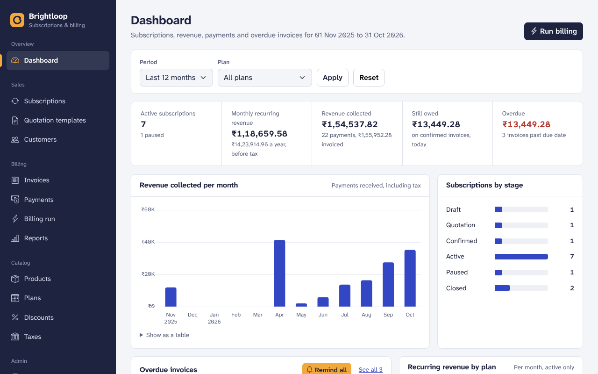
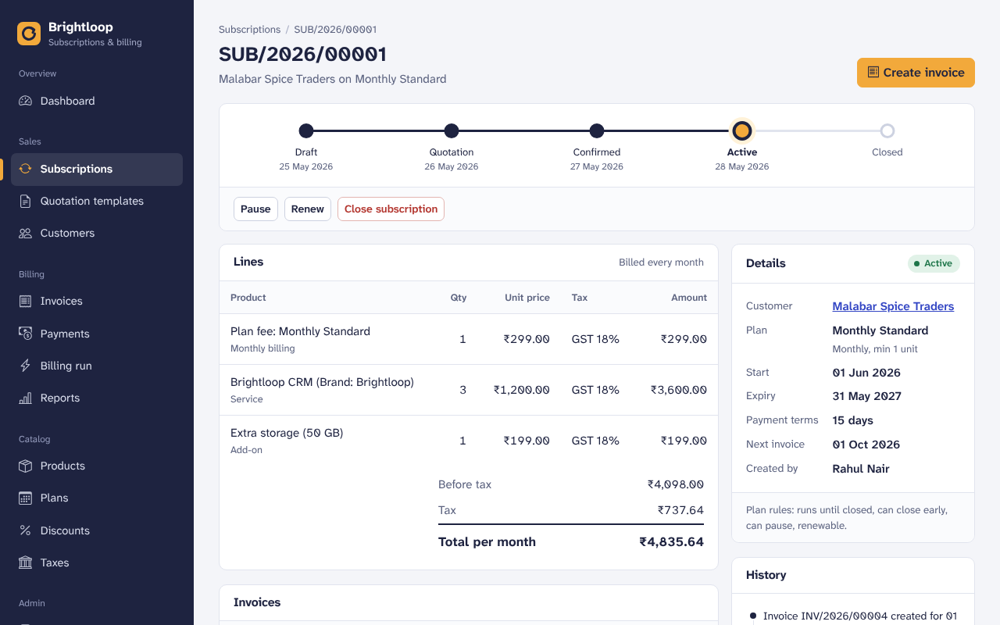
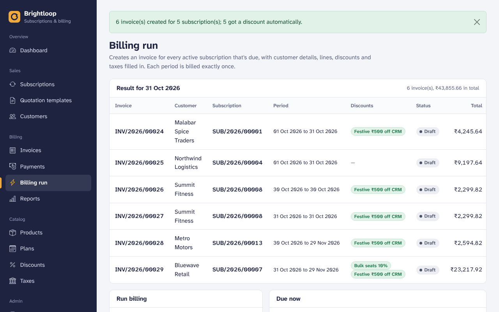
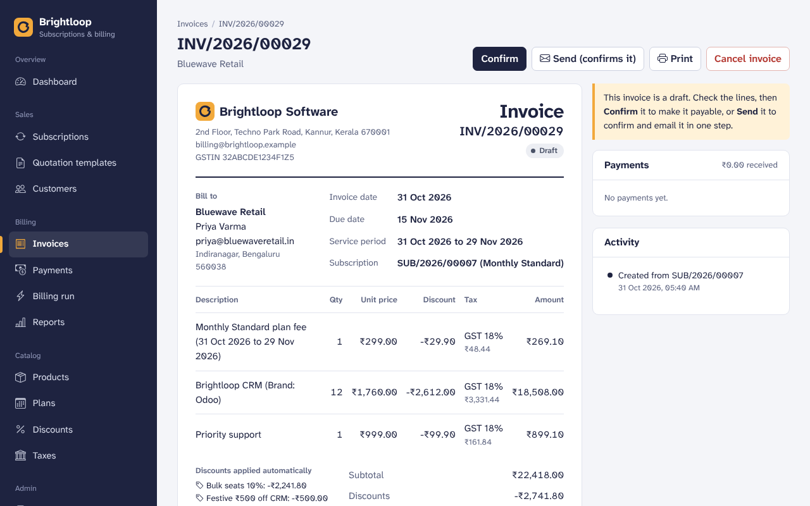
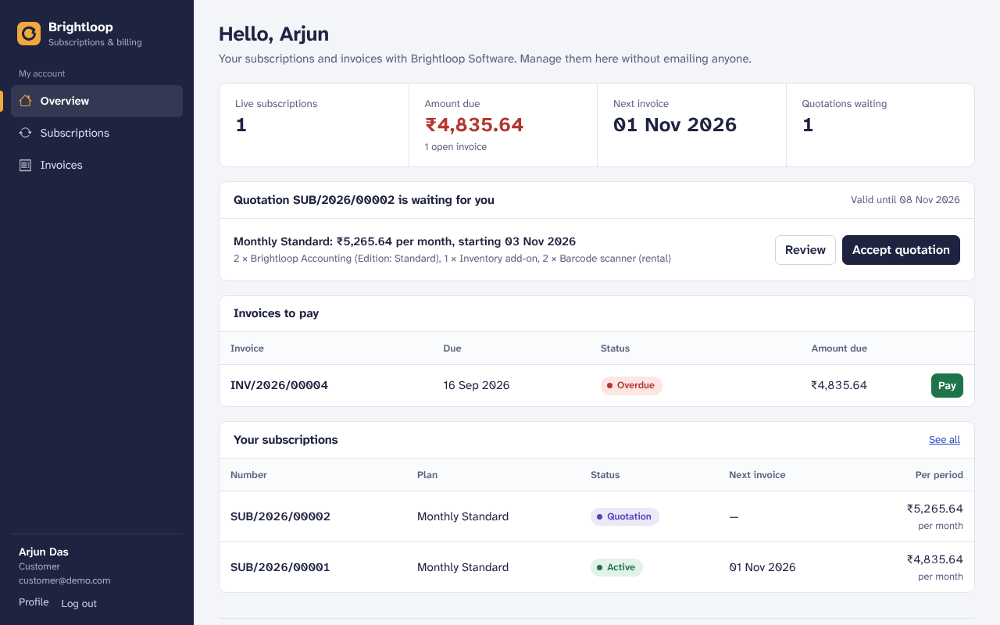
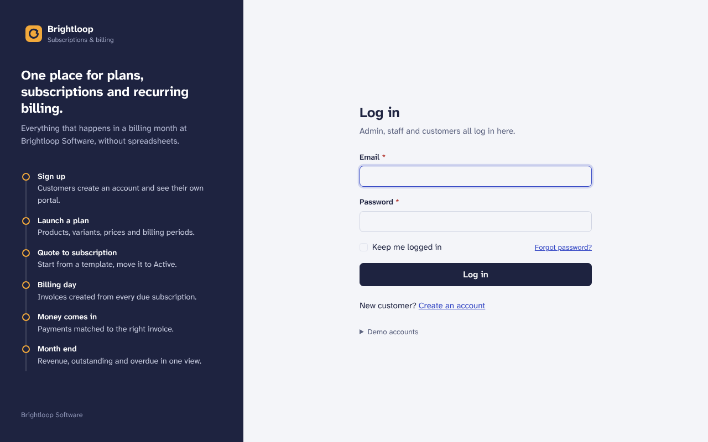

# Subscription Management System

One system to run plans, subscriptions and recurring billing for **Brightloop Software**, built for the Odoo x Make-A-Ton 9.0 hackathon (virtual round).

**Stack:** Python, Flask, SQLite (through SQLAlchemy), Bootstrap 5, Chart.js. All CSS, JS and fonts are stored in the repo, so the app runs offline.

| Finance dashboard | Subscription lifecycle |
|---|---|
|  |  |
| **Billing run with automatic discounts** | **Invoice with taxes and discounts** |
|  |  |
| **Customer portal** | **Log in** |
|  |  |

## The brief, scene by scene

| Scene in the problem statement | Where it lives in the app |
|---|---|
| A new customer signs up (unique email, password rules, reset link, roles) | Create an account, Forgot password, Team (admin only) |
| Launching a new plan (product, variants such as Odoo +560, plan price, period, minimum quantity, dates, close/pause/renew rules) | Products, Plans |
| Turning a quote into a subscription (templates with validity, numbered subscriptions, Draft → Quotation → Confirmed → Active → Closed) | Quotation templates, Subscriptions |
| Billing day (invoices created from subscriptions, automatic taxes, confirm/cancel/send/print, never billed twice or skipped) | Billing run, Invoices |
| A customer asks for a better price (admin-only discount rules that apply on their own and stop when expired or used up) | Discounts, then any invoice |
| The money comes in (method, amount, date, note; paid vs outstanding vs overdue) | Invoice page, Payments, Invoices filters |
| The finance lead at month end (active subscriptions, revenue, payments, overdue, filters, summary, under 2 seconds with thousands of rows) | Dashboard, Reports, `seed.py --bulk 3000` |
| Customers manage their own subscriptions | Customer portal |

## Run it (Windows)

```
py -m venv .venv
.venv\Scripts\python -m pip install -r requirements.txt
.venv\Scripts\python app.py
```

Open http://127.0.0.1:5000. The first start creates the database and demo data.

To wipe the database and load fresh demo data at any time:

```
.venv\Scripts\python seed.py
```

On macOS/Linux use `python3 -m venv .venv`, then `.venv/bin/python` in place of `.venv\Scripts\python`.

## Demo logins

| Role | Email | Password |
|---|---|---|
| Admin | admin@brightloop.com | Admin@12345 |
| Staff | staff@brightloop.com | Staff@12345 |
| Customer | customer@demo.com | Customer@123 |

## Features

### Accounts and roles
- Sign up with email and password. One account per email (unique, case-insensitive).
- Password rules from the brief, checked on the server and shown live while typing: more than 8 characters, an uppercase letter, a lowercase letter and a special character.
- Forgot password: a one-time reset link that expires in 1 hour is emailed to the registered address. Without email settings the message goes to the in-app Email outbox, and the demo shows the link on screen.
- Three roles. **Admin** controls everything. **Staff** handle day-to-day work with limited access. **Customers** see only their own subscriptions and invoices in a portal. Only the admin can add staff.

### Catalog (admin sets it up, staff can view)
- **Products** with name, type (service, goods, add-on), sales price, cost price, margin, tax and notes.
- **Variants** such as Brand: Odoo (+₹560). Final price = sales price + extra price.
- **Taxes**: rates set by the admin. A line uses its product's tax, otherwise the default tax.
- **Plans**: plan fee, billing period (daily, weekly, monthly, yearly), minimum quantity, availability dates, and per-plan rules: close automatically at expiry, close early, pause, renew.
- **Discounts** (admin only): percentage or fixed amount, minimum purchase or quantity, start and end dates, usage limit, for whole subscriptions or specific products.

### Sales
- **Customers**: staff add customers and email them a portal invite (a 7-day link to set their password).
- **Quotation templates**: a plan plus product lines and a validity period in days, ready to turn into a subscription.
- **Team**: only the admin can add staff. New members get an invite link and choose their own password.

### Subscriptions
- Each subscription gets its own number (SUB/2026/00001), a customer, a plan, start and expiry dates, payment terms and product lines (product, quantity, unit price, tax, amount).
- Start from a quotation template: plan, lines and the quote's valid-until date fill in automatically.
- Lifecycle: **Draft → Quotation → Confirmed → Active → Closed**, shown as a progress rail on every subscription, with a full history log of who changed what and when.
- The plan's rules are enforced: availability dates, minimum quantity, close early, pause/resume, renew, and automatic closing at expiry. Blocked actions say why.
- Confirmed subscriptions start automatically on their start date; expired ones on auto-close plans close on their own.
- "Send quotation" emails the customer a summary; expired quotations can't be confirmed.

### Billing
- **Billing run**: one click invoices every active subscription that is due, with customer details, product lines, discounts and taxes filled in. Missed periods are caught up.
- **Nothing billed twice, nothing skipped**: one invoice per subscription period, checked in code and enforced by a unique database index (cancelled invoices excluded). Cancelling the latest invoice makes its period billable again.
- Monthly periods are counted from the start date, so a subscription that starts on the 31st keeps billing at month end.
- **Taxes** are calculated per line from the admin's rules. **Discounts** apply on their own when their rules match (dates, minimum purchase or quantity, products) and stop when they expire or reach their usage limit.
- Invoices move **Draft → Confirmed → Paid** (or Cancelled). The team can confirm, cancel, send (email) and print (save as PDF from the browser).

### Payments
- Record payments with method, amount, date, reference and note against the right invoice. Part payments are supported; overpaying is blocked.
- Invoice lists filter by paid, outstanding and overdue, with totals for invoiced, collected and still owed.
- **Email outbox**: every email the system sends (reset links, invites, quotations, invoices) is listed in the app.

### Finance dashboard
- One page for the finance lead: active subscriptions, monthly recurring revenue, revenue collected, amount still owed and overdue invoices.
- Filters for period (this month, last month, quarter, year, last 12 months or custom dates) and plan.
- Revenue collected per month (chart plus a table view), subscriptions by stage, overdue invoices, recurring revenue by plan, renewals coming up and the latest payments. Every number links to the matching filtered list.

### Chasing overdue invoices and reports
- **Payment reminders**: one click emails a reminder for a single invoice, or for every overdue invoice at once (from the dashboard or the Overdue list). Each reminder shows in the invoice's activity.
- **Reports**: revenue by month (invoiced, discounts, tax, collected), by plan (active subscriptions, monthly recurring revenue) and top customers, for any date range.
- **CSV downloads** of every report and of any filtered invoice list, ready for Excel or Google Sheets.

### Customer portal
- Customers see only their own subscriptions and invoices (anything else returns "not found").
- Accept or decline quotations, pause/resume, renew or close a subscription when its plan allows it, and switch add-ons on or off.
- View, print and pay invoices (the "Pay now" button records a test payment; no real gateway is connected).

## Performance: thousands of subscriptions

The brief asks for every page to answer in under two seconds with thousands of subscriptions. Load a big data set and check:

```
.venv\Scripts\python seed.py --bulk 3000
```

This adds 1,000 customers, 3,000 subscriptions, about 11,600 invoices and 11,200 payments in a few seconds. Every page shows its server time in the footer. Measured on a laptop with that data:

| Page | Server time |
|---|---|
| Dashboard (last 12 months) | ~75 ms |
| Subscriptions, invoices, payments, customers (any page, any filter) | 5–50 ms |
| Reports | ~55 ms |
| Billing run: 1,697 due subscriptions, 2,842 invoices | ~1.6 s |

How: every list is paginated, totals are computed in SQL (not Python loops), foreign keys and status/date columns are indexed, and a billing run loads taxes, discounts and existing periods once instead of per invoice.

## Tests

```
.venv\Scripts\python -m pip install -r requirements-dev.txt
.venv\Scripts\python -m pytest -q
```

24 tests cover the brief's rules: password rules, unique emails, one-time reset links, role access, the Odoo +560 variant, plan minimums and availability, the subscription lifecycle, plan rules (pause/close), auto-close at expiry, no double billing (in code and in the database), re-billing after a cancel, automatic discounts and usage limits, tax totals, payments, portal privacy, and month-end billing dates.

## Real email (optional)

Without settings, every email is saved to the in-app **Email outbox**, so the demo works offline. To send real emails (for example with Gmail):

1. Turn on 2-Step Verification for the Google account, then create an **App password**.
2. Copy `.env.example` to `.env` and fill in:
   ```
   MAIL_SERVER=smtp.gmail.com
   MAIL_PORT=587
   MAIL_USERNAME=you@gmail.com
   MAIL_PASSWORD=your-16-character-app-password
   MAIL_FROM=you@gmail.com
   ```
3. Restart the app. Reset links, invites, quotations, invoices and reminders now arrive by email (and are still listed in the outbox).

## Scheduled jobs (optional)

Billing and reminders can run without anyone clicking, e.g. from Windows Task Scheduler or cron:

```
.venv\Scripts\flask --app app run-billing --confirm
.venv\Scripts\flask --app app send-reminders
```

## Project structure

```
app.py            Flask app: setup, navigation, error pages
config.py         Settings (database path, company details, email)
models.py         Every database table, relation and constraint
utils.py          Form validation, role checks, formatting, reset tokens
seed.py           Demo data (python seed.py resets it; --bulk 3000 adds a big data set)
tests/            Automated tests (pytest)
routes/           One blueprint per area (auth, dashboard, portal, ...)
services/         Business logic (email, billing, ...)
templates/        Jinja pages; _macros.html holds shared form/status pieces
static/           CSS, JS, fonts and vendored Bootstrap
```

## Data integrity and security
- SQLite with foreign keys switched on, CHECK constraints (no negative prices, valid statuses, valid date ranges) and UNIQUE constraints (emails, document numbers).
- Every form is validated on the server. Errors appear next to the field and the form keeps what was typed.
- CSRF protection on every form; passwords are hashed (scrypt); reset and invite links are signed, expire, and stop working once used.
- Customers can only open their own records: anything else returns "not found".
- Once real email is switched on, the Email outbox hides password links so staff can't use them.
